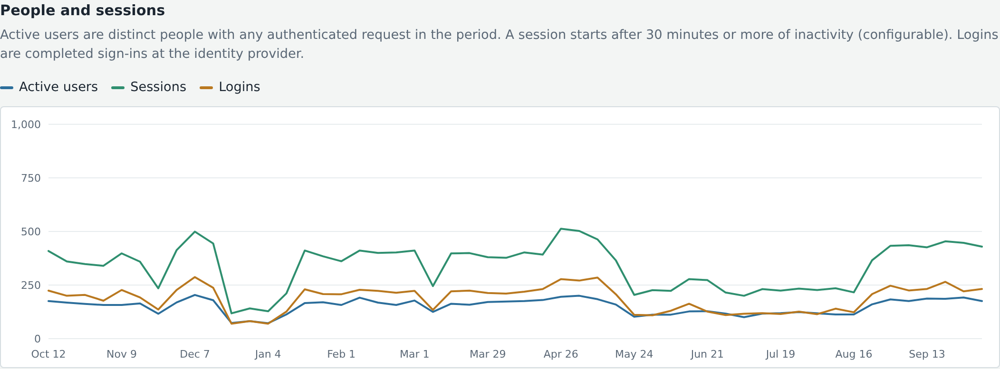
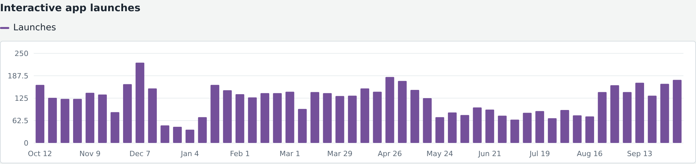
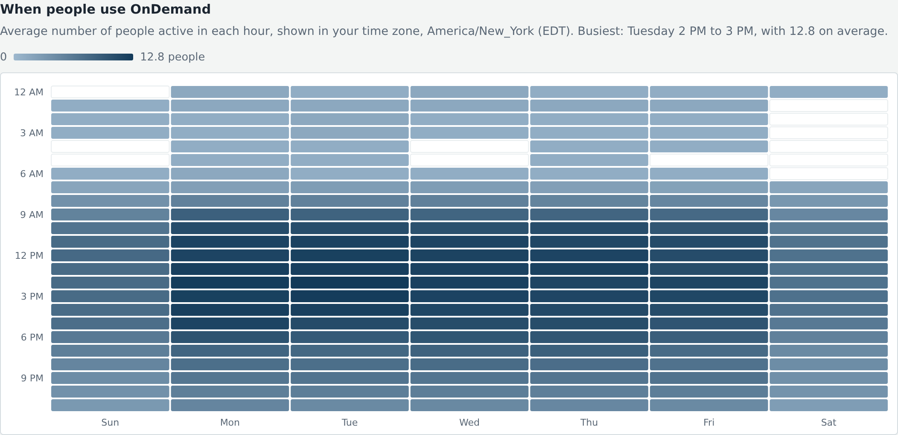

# ood-analytics
Open OnDemand app that reports how your portal is used and where it's failing. A collector reads the Apache access logs (and Slurm accounting, if you use Slurm) on a timer and keeps daily aggregates in a small SQLite database, so history outlives log rotation. A read-only dashboard, installed as a system app for admins, shows logins, sessions, active users, interactive app launches and their wall time, use of the built-in tools, when people are active, and the errors and slow pages they run into.

## Sample reports

A year of simulated data for a campus portal, grouped by week.







# Features
- Logins, sessions, and active users by day, week, month, or year, with presets, calendar years, and custom ranges
- Interactive app launches and failed launches, by app
- Interactive app wall time, core hours, and GPU hours from Slurm accounting (detected automatically from your OnDemand cluster configs)
- Use of Files, Shell, Active Jobs, Job Composer, and any other Passenger app
- Click any interactive app or tool name to see its own trend and top users
- Day-of-week by hour-of-day activity heatmap, shown in each viewer's own time zone
- Issues page: server and client errors by area, failed personal web server starts, slow pages, and the people most affected
- Most active users, plus CSV downloads of the time series and per-user totals
- History is kept after Apache rotates its logs; the collector never double counts and follows rotation and compression
- Python standard library only, with no pip packages, CDNs, or external fonts, so it works on an air-gapped portal

## Requirements

### OnDemand host

* Python 3.6+ and SQLite 3.24+ (both stock on EL8 and EL9)
* Root access to install the collector and its systemd timer, since the Apache logs are root-readable
* For wall time: `sacct` with access to `slurmdbd` on the host where the collector runs
* For slow-page reporting: `%D` added to Apache's log format (see [Issues page](#issues-page))

### Open OnDemand
* Open OnDemand 4.0+
* Slurm, optional; without it the wall-time sections are hidden

## App Installation

### 1. Clone the repository
```bash
# Passenger apps:
cd /var/www/ood/apps/sys

git clone https://github.com/TuftsRT/ood-analytics
cd ood-analytics

# Pin to a release (recommended)
git checkout v1.0.0
```

### 2. Configure for your site

Install the collector, its config, and its timer from the checkout. Replace `ood-admins` with whatever group should be able to see the dashboard, here and as `db_group` in the config.

```bash
install -m 0755 ood-usage-collect /usr/local/sbin/ood-usage-collect
install -m 0644 config.example.json /etc/ood/config/ood_usage.json
$EDITOR /etc/ood/config/ood_usage.json   # set db_group, log_globs, user_regex, site_name

# First run reads the last lookback_days (default 7); see Configuration
/usr/local/sbin/ood-usage-collect -v

# Keep it running every 15 minutes
install -m 0644 ood-usage-collect.{service,timer} /etc/systemd/system/
systemctl daemon-reload
systemctl enable --now ood-usage-collect.timer

# Make the dashboard visible only to the admin group
chgrp -R ood-admins /var/www/ood/apps/sys/ood-analytics
chmod -R o-rwx /var/www/ood/apps/sys/ood-analytics
```

The settings most sites need to change are `log_globs` (where your access logs are), `user_regex` (to turn `jdoe01@tufts.edu` into `jdoe01`), and `db_group`. If your interactive apps set `job_name` in `submit.yml.erb`, also check `slurm_job_patterns`. Everything is described under [Configuration](#configuration).

OnDemand hides a system app from anyone who can't read its directory, and the database is mode 0640 owned by `root:<db_group>`, so non-admins are blocked at both layers.

### 3. Verify

No OOD restart is needed. Visit `https://<your-ood-host>/pun/sys/ood-analytics/` as a member of the admin group; the issues page is at `/pun/sys/ood-analytics/issues`. The manifest puts the app under an **Admin** category; if you define a custom `nav_bar`, add the app to it (or link to it directly) for it to show in the menu.

If the page says usage data is unavailable, it names the config file and database it's looking for; see [Troubleshooting](#troubleshooting).

## How history is preserved

Only daily aggregates are stored: one row per (day, user, category, item) with a count. Raw log lines are never copied. Each log file is identified by a hash of its first line and read from a stored byte offset, and the new counts and the new offset are committed in the same transaction. That means the collector can run as often as you like without double counting, and it follows files through rename rotation, `copytruncate`, and compression to `.gz`, `.bz2`, or `.xz`. A partial last line in the live log is left for the next run.

Size is modest. Expect very roughly 10 to 15 rows per active user per day (about half of them the hourly activity behind the heatmap), so 1,000 daily users for a year is around five million rows and a few hundred MB.

The database is now the only copy of history older than your log retention, so include `/var/lib/ood-usage/usage.db` in backups. A consistent copy can be taken while the collector is idle with `sqlite3 usage.db ".backup /path/to/copy.db"`.

## Configuration

Everything lives in `/etc/ood/config/ood_usage.json`, alongside OnDemand's own configuration. Both the collector and the dashboard read it; set `OOD_USAGE_CONFIG` in the environment to use a different path (for the collector, `-c` also works).

`db_path` should sit in a directory of its own: on every run the collector sets that directory's group to `db_group` and its mode to 0750, and the database file's to 0640.

`log_globs` should match the live access log and every rotated copy. The OnDemand default is `/var/log/httpd/<servername>_access_ssl.log`, so `*_access_ssl.log*` catches it plus rotated `-YYYYMMDD` and `.gz` files. The parser expects Apache's `combined` (or `common`) format, which is what the portal generator writes by default. Extra fields appended after the status code are fine, with one caveat: a single number after the last quoted field is read as the response time (see the issues page below).

`lookback_days` (default 7) limits how far back the collector reads data it hasn't collected yet, both access-log lines and Slurm jobs. On the first run that means the last 7 days; log files last modified before then aren't opened. To backfill more for the first run, set it to a larger number, such as 365 for a year of logs still on disk and a year of Slurm accounting (roughly ten minutes on a busy cluster), then set it back. `null` removes the limit entirely; for Slurm that means querying from 1970 onward in 30-day steps, so prefer a number. If the collector hasn't run for longer than the lookback, it reads back to its last run anyway, so downtime doesn't leave a gap.

`user_regex` normalizes the Apache `%u` field. With OIDC this is the value of `OIDCRemoteUserClaim`, often an email address or ePPN, so `^([^@]+)@` reduces `jdoe01@tufts.edu` to `jdoe01`. Set it to `null` to store the field as-is. `exclude_users` drops service or monitoring accounts.

`login_patterns` are regexes matched against `METHOD /path?query` for responses with a 3xx status. The defaults cover the mod_auth_openidc redirect URI at `/oidc` (code and form_post response modes), Shibboleth's SAML2 POST endpoint, and Dex. If your redirect URI differs, change the first two patterns. Auth callbacks are usually logged before `REMOTE_USER` exists, so each one is attributed to the next authenticated request from the same client IP within `login_attribution_seconds`. Anything that can't be matched is counted under `(unknown)`, which the dashboard reports separately.

`app_patterns` is an ordered list of `[label, regex]` pairs matched against the URL path; the first match wins. With `count_other_passenger_apps` on, any unmatched `/pun/<type>/<app>` request is counted under `sys/<app>`, `dev/<app>`, or `usr/<owner>/<app>`, so custom Passenger apps show up without configuration. Changes to labels apply only to logs processed after the change; earlier history keeps the labels it was recorded with.

Wall time comes from the scheduler, because the access log only records the launch, and `walltime` controls it. The default, `auto`, reads OnDemand's cluster configs in `ood_clusters_dir` (`/etc/ood/config/clusters.d`) and turns wall time on only if a cluster uses `adapter: slurm`; sites on other schedulers get the rest of the dashboard with the wall-time sections hidden. `slurm` forces it on and `off` turns it off (which also hides any wall time already collected). Slurm is currently the only supported scheduler.

When on, each collector run calls `sacct -a` for jobs that finished since the last run, once per cluster, so the host it runs on needs `sacct` and access to `slurmdbd`. The cluster names (`v2.job.cluster`, passed as `-M`) and the `sacct` location (`bin_overrides.sacct` or `bin`) are taken from the cluster configs; set `slurm_clusters` or `sacct_path` to override them. A cluster with no records in this host's `slurmdbd` simply contributes nothing. A job counts as an interactive app if its name matches one of `slurm_job_patterns`, and the regex's first capture group becomes the app name. OnDemand's default job name is `[portal/]sys/dashboard/sys/<app>`; sites that set `job_name` in `submit.yml.erb` (such as `OnDemand/<App>`) need a matching pattern. How far back the first run reads is set by `lookback_days`, described above.

`show_top_users` set to `false` removes the per-user tables (most active users, and people most affected on the issues page) and the per-user CSV from the dashboard. The data is still collected because it's what makes "distinct users per month" accurate over any range.

## What each number means

An **active user** is a distinct person with at least one authenticated request in the period. A **session** starts with a user's first request after `session_gap_minutes` (default 30) without any requests; this works the same regardless of how long your IdP or Apache session cookies last. A **login** is a completed sign-in at the identity provider, so users with long-lived SSO cookies may have many sessions per login.

An **interactive app launch** is a `POST` to `.../batch_connect/<app>/session_contexts` that redirected to the sessions page, which is what OnDemand does when the job is submitted. A response other than a redirect (the form re-rendered with a validation error, or a scheduler submission error) is counted as **failed**. App names are the batch_connect token, such as `jupyter`, `bc_desktop`, or `usr/jdoe/myapp` for shared apps; `sys/` is hidden in the display.

**Wall hours** are the elapsed time of finished interactive app jobs, from Slurm start to end. A job is counted when it finishes, so running sessions don't show up yet, and a job that runs past midnight is split across the days it ran. **Core hours** and **GPU hours** multiply wall time by the CPUs and GPUs allocated. Wall-time app names come from the Slurm job name, so they can differ from the launch names (for example `Jupyter` versus `jupyter`).

The **day-of-week by hour-of-day heatmap** shows the average number of distinct people active in each hour, in the viewer's own time zone (named above the chart). The collector stores each active hour in UTC, taken from the offset on the log line, and the browser places it on its local weekday and hour, so daylight-saving changes are handled. Each cell averages over every time that local hour occurs in the selected range within the collected hourly history, so quiet hours count as zero and time before hourly collection began doesn't dilute it. Hourly data is only recorded from the version that added the heatmap onward; earlier history has daily totals only.

Clicking an app or tool name in the interactive apps, wall time, or tools table filters the usage page to just that item: its own totals, trend charts, and top users for the selected range, until you choose **Show everything**. The filter is kept in the URL, so a filtered view can be bookmarked or shared. Launches and wall time are filtered separately, because launch names (form tokens such as `sys/matlab_server`) and wall-time names (Slurm job names such as `matlab`) don't reliably match. The heatmap isn't broken down by app.

**User-days** for a tool counts each person once per day they made a non-static request to it. Requests for JavaScript, CSS, images, and fonts are ignored for tool counts so page loads don't inflate the numbers.

Days are in the server's local time as written in the log, and the dashboard footer names that time zone. Weeks start on Sunday, in the weekly grouping and the heatmap alike. The Year menu selects a calendar year; the current year runs through today.

## Issues page

`/issues` (linked from the dashboard header) reports problems found in the same access logs: HTTP 5xx server errors and 4xx client errors by area and status, each area's error rate, failed starts of people's personal web servers (`/nginx/start`), and who was affected most. Unauthenticated requests count too, under `(unknown)`. The areas are the `app_patterns` labels, so a 502 under an app usually means that person's web server crashed or was restarting, and under Interactive App Connections that the app's session had ended.

Slow page loads need response times, which Apache's default `combined` format doesn't log. Append `%D` (microseconds) to the access log format in `/etc/ood/config/ood_portal.yml`, then run `/opt/ood/ood-portal-generator/sbin/update_ood_portal` and restart Apache:

```yaml
logformat: '"%h %l %u %t \"%r\" %>s %b \"%{Referer}i\" \"%{User-Agent}i\" %D"'
```

From then on the collector records a response-time histogram per area (median and 95th percentile, to bucket resolution) and counts requests slower than `slow_request_seconds` (default 3). It reads the time from a single number after the last quoted field; if your format ends in `%T` instead, set `response_time_format` to `"%T"` (or `"%{ms}T"`), and set it to `null` to ignore timings. Static files, websockets, and traffic to running interactive apps aren't timed, since their durations aren't page loads. Error tracking starts with the collector version that added it.

## API

The dashboard is backed by four read-only endpoints, all taking `start` and `end` as `YYYY-MM-DD` and `group` as `day`, `week`, `month`, or `year`:

`api/summary` returns everything on the usage page as JSON, and `api/issues` everything on the issues page. `api/summary` also takes `filter=launch:<token>`, `filter=job:<Slurm app>`, or `filter=tool:<label>` and then adds a `focus` object for that one item. `api/series.csv` returns the time series. `api/users.csv` returns per-user totals for the range (disabled when `show_top_users` is false).

Because the database is plain SQLite with a simple schema, you can also query it directly or ship it elsewhere. For example, distinct users by month for all time:

```sql
SELECT substr(day, 1, 7) AS month, COUNT(DISTINCT user)
FROM usage WHERE category = 'active' GROUP BY month;
```

## Troubleshooting

Run `ood-usage-collect -v` to see each file it reads and how many new lines it found. If the dashboard says it cannot read the database, check that your account is in `db_group` and that the directory `/var/lib/ood-usage` is group-readable (the collector resets this to 0750 and the file to 0640 on every run). If logins show as zero but sessions look right, your IdP callback URL doesn't match `login_patterns`; grep the access log for the redirect URI and adjust. If many logins show as `(unknown)`, users are probably reaching OnDemand through a proxy that changes the client IP between the callback and the next request; consider logging `X-Forwarded-For` as the first field.

Passenger needs a Python 3 interpreter for this app. OnDemand's default `passenger_python` works on OnDemand 4.0; if you've set it in `/etc/ood/config/nginx_stage.yml`, it must point at Python 3.6 or newer (for example `/usr/bin/python3`), and users need to restart their web server from the Help menu for a change to apply.

After updating the app (for example after `git pull`), restart it with `touch tmp/restart.txt` in its directory, or Help → Restart Web Server; Passenger keeps the Python code loaded until then. The page template is read on every request, so a template change alone needs only a reload.

## Contributing

Contributions are welcome. To contribute:

1. Fork this repository
2. Create a feature branch (`git checkout -b feature/my-improvement`)
3. Submit a pull request with a description of your changes

For bugs or feature requests, [open an issue](https://github.com/TuftsRT/ood-analytics/issues).

This app is part of the [OOD Appverse](https://ondemand.connectci.org/affinity-groups/ood-appverse). Join the [Appverse Affinity Group](https://ondemand.connectci.org/affinity-groups/ood-appverse) to connect with other contributors.

## License

[MIT License](LICENSE)
